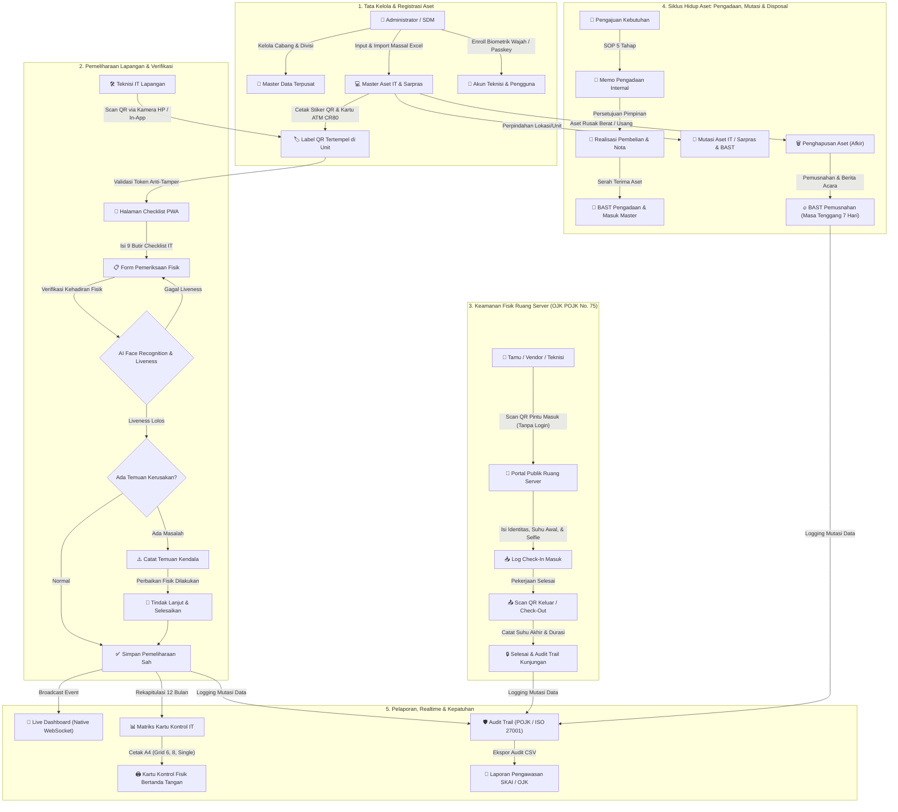
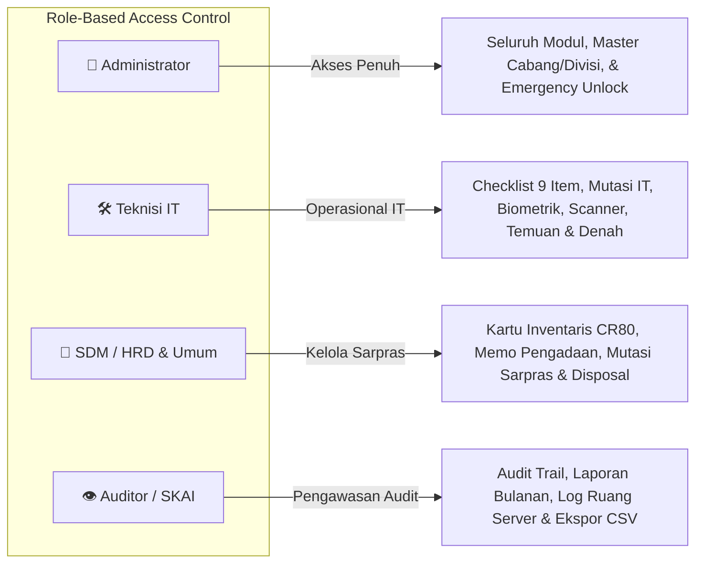

# 🖥️ QR Maintenance — Sistem Tata Kelola Aset IT, Sarpras, & Keamanan Perbankan Berbasis QR Code, AI Biometrik, & Buku Tamu Ruang Server (OJK POJK No. 75)

[](https://www.php.net/)
[](https://web.dev/progressive-web-apps/)
[](https://fidoalliance.org/)
[](https://github.com/justadudewhohacks/face-api.js)
[](https://developer.mozilla.org/en-US/docs/Web/API/WebSockets_API)
[](https://cloud.google.com/docs)
[](https://www.ojk.go.id/)
[](https://vercel.com/)

Aplikasi web modern berbasis **PHP Native Modular** untuk tata kelola siklus hidup aset IT & Sarpras secara *end-to-end*, pemeliharaan berkala (*preventive maintenance*), otomatisasi **Kartu Kontrol IT 12 Bulan**, **Kartu Inventaris Standar ATM (CR80)**, alur **Pengadaan & Memo Internal**, **Penghapusan / Pemusnahan Aset (Afkir)**, serta modul **Buku Tamu & Pengawasan Akses Ruang Server (Dual QR Code)** yang memenuhi standar kepatuhan regulasi perbankan **OJK POJK No. 75/POJK.03/2016** dan **ISO 27001**.

Aplikasi ini mendukung **Dual-Storage Engine**: dapat berjalan secara *serverless* menggunakan **Google Cloud Sheets API v4** (tanpa biaya database server di Vercel) maupun menggunakan **Database MySQL Enterprise** di VPS/Server Produksi On-Premise (XAMPP / Laragon / Nginx / Hostinger).

---

## 📑 Daftar Isi
1. [Arsitektur & Alur Kerja Sistem (System Workflow)](#-arsitektur--alur-kerja-sistem-system-workflow)
2. [Matriks Fitur Unggulan Sistem (Feature Matrix)](#-matriks-fitur-unggulan-sistem-feature-matrix)
3. [Alur Operasional Step-by-Step](#-alur-operasional-step-by-step)
   - [A. Manajemen Master Data, Cabang, & Pengguna](#a-manajemen-master-data-cabang--pengguna)
   - [B. Registrasi Aset IT, Import Massal Excel, & Cetak Stiker QR](#b-registrasi-aset-it-import-massal-excel--cetak-stiker-qr)
   - [C. In-App QR Scanner & PWA Mobile App](#c-in-app-qr-scanner--pwa-mobile-app)
   - [D. Pemeliharaan Rutin 9 Butir IT & Verifikasi Biometrik](#d-pemeliharaan-rutin-9-butir-it--verifikasi-biometrik)
   - [E. Penanganan Temuan Kendala IT (Findings & Resolution)](#e-penanganan-temuan-kendala-it-findings--resolution)
   - [F. Kartu Kontrol 12 Bulan & Cetak Fisik](#f-kartu-kontrol-12-bulan--cetak-fisik)
   - [G. Kartu Inventaris Standar ATM (CR80) & Ekspor Word/PDF](#g-kartu-inventaris-standar-atm-cr80--ekspor-wordpdf)
   - [H. Buku Tamu Digital & Pengawasan Ruang Server (Dual QR OJK)](#h-buku-tamu-digital--pengawasan-ruang-server-dual-qr-ojk)
   - [I. Alur SOP 5-Tahap Memo Pengadaan & Berita Acara](#i-alur-sop-5-tahap-memo-pengadaan--berita-acara)
   - [J. Penghapusan / Pemusnahan Aset (BAST Afkir)](#j-penghapusan--pemusnahan-aset-bast-afkir)
   - [K. Mutasi Aset IT & Sarpras](#k-mutasi-aset-it--sarpras)
   - [L. Denah Ruangan Interaktif (Floor Plan Mapping)](#l-denah-ruangan-interaktif-floor-plan-mapping)
   - [M. Galeri Foto Aset Rasio 4:5 & Kamera Langsung](#m-galeri-foto-aset-rasio-45--kamera-langsung)
   - [N. Dashboard Real-Time Native WebSocket (RFC 6455)](#n-dashboard-real-time-native-websocket-rfc-6455)
   - [O. Audit Trail Terpusat & Kepatuhan POJK No. 75](#o-audit-trail-terpusat--kepatuhan-pojk-no-75)
4. [9 Standar Checklist Pemeliharaan IT](#-9-standar-checklist-pemeliharaan-it)
5. [Hak Akses & Multi-Role Pengguna (RBAC)](#-hak-akses--multi-role-pengguna-rbac)
6. [Struktur Direktori & Peta Modul](#-struktur-direktori--peta-modul)
7. [Panduan Lengkap Setup & Instalasi dari Nol (Zero-to-Hero)](#-panduan-lengkap-setup--instalasi-dari-nol-zero-to-hero)
   - [7.1 Topologi Jaringan & Spesifikasi Server](#71-topologi-jaringan--spesifikasi-server)
   - [7.2 Langkah 1: Persiapan Server Linux (Ubuntu 24.04 LTS)](#72-langkah-1-persiapan-server-linux-ubuntu-2404-lts)
   - [7.3 Langkah 2: Setup Database MariaDB / MySQL](#73-langkah-2-setup-database-mariadb--mysql)
   - [7.4 Langkah 3: Deploy Kode Aplikasi & Izin Direktori](#74-langkah-3-deploy-kode-aplikasi--izin-direktori)
   - [7.5 Langkah 4: Konfigurasi Web Server Nginx (SSL & Anti-403)](#75-langkah-4-konfigurasi-web-server-nginx-ssl--anti-403)
   - [7.6 Langkah 5: Optimasi Kernel Linux TCP Sysctl (Anti-Timeout)](#76-langkah-5-optimasi-kernel-linux-tcp-sysctl-anti-timeout)
   - [7.7 Langkah 6: Konfigurasi Router MikroTik (Dual WAN & Subnet 88)](#77-langkah-6-konfigurasi-router-mikrotik-dual-wan--subnet-88)
   - [7.8 Langkah 7: Konfigurasi Komputer Klien (PC Kantor)](#78-langkah-7-konfigurasi-komputer-klien-pc-kantor)
   - [7.9 Langkah 8: Mobile QR Scanner Tanpa Login](#79-langkah-8-mobile-qr-scanner-tanpa-login)
   - [7.10 Langkah 9: Deploy Otomatis 1-Klik (`deploy.bat` / `deploy.ps1`)](#710-langkah-9-deploy-otomatis-1-klik-deploybat--deployps1)
   - [7.11 Langkah 10: Menjalankan Server WebSocket Real-Time](#711-langkah-10-menjalankan-server-websocket-real-time)
   - [7.12 Langkah 11: Deployment Serverless ke Vercel (Google Sheets API)](#712-langkah-11-deployment-serverless-ke-vercel-google-sheets-api)
8. [Akun Default & Standar Keamanan Sistem](#-akun-default--standar-keamanan-sistem)
9. [Panduan Troubleshooting & Solusi Eror Nyata](#-panduan-troubleshooting--solusi-eror-nyata)

---

## 🚀 Arsitektur & Alur Kerja Sistem (System Workflow)



---

## ✨ Matriks Fitur Unggulan Sistem (Feature Matrix)

| Kategori | Modul & Fitur | Keunggulan & Penjelasan Teknis |
|---|---|---|
| **🚪 Keamanan Ruang Server** | **Buku Tamu Digital Ruang Server (OJK)** | Portal akses resmi ruang server berbasis **Dual QR Code Pintu** (Masuk & Keluar) yang memenuhi regulasi Otoritas Jasa Keuangan (**POJK No. 75/POJK.03/2016**) dan **ISO 27001 Annex A.11**. |
| | **Public Portal Scan (Tanpa Login)** | Tamu, vendor luar, maupun auditor dapat langsung memindai QR pintu menggunakan smartphone tanpa akun login. Dilengkapi perekaman selfie, foto identitas, keperluan, pencatatan suhu awal/akhir ruang server, dan perhitungan durasi otomatis. |
| | **Stiker Pintu Resmi Siap Cetak (A4)** | Layout stiker resmi siap tempel di pintu masuk & keluar ruang server lengkap dengan panduan SOP 3 langkah dan banner peringatan pengamanan. |
| **📑 Pengadaan & Memo** | **SOP Pengadaan 5 Tahap** | Siklus pengadaan terstandarisasi: Pengajuan Memo Internal $\rightarrow$ Persetujuan Direksi/Pimpinan $\rightarrow$ Realisasi Pembelian Toko & Bukti Nota $\rightarrow$ Berita Acara Pengadaan $\rightarrow$ Masuk Master Aset. |
| | **Template Memo Resmi Bank Mitra** | Format persis memo internal bank: logo Bank Mitra proporsional (105px), penomoran auto-increment anti-bentrok, rincian biaya estimasi vs harga fix nota toko, dan upload scan dokumen bertanda tangan basah. |
| | **BAST Pengadaan 1 Halaman A4** | Cetak Berita Acara Pengadaan presisi 1 halaman A4 lengkap dengan lembar lampiran nota fisik dan persetujuan pejabat berwenang. |
| **🗑️ Penghapusan Aset (Afkir)** | **Disposal & Pemusnahan Aset** | Modul resmi penghapusan aset inventaris dan komputer rusak. Sesuai kebijakan tata kelola perbankan: aset **murni dimusnahkan/diafkir** (tidak diperjualbelikan). |
| | **Masa Tenggang 7 Hari (Grace Period)** | Dilengkapi fitur pemulihan aset kembali ke master inventaris jika terjadi kekeliruan administrasi dalam 7 hari sebelum status pemusnahan permanen. |
| | **BAST Pemusnahan / Disposal** | Cetak Berita Acara Serah Terima Pemusnahan Aset format A4 resmi dengan susunan komite saksi, metode pemusnahan (degaussing, shredding, recycling), dan arsip scan berkas. |
| **🔄 Mutasi Aset & BAST** | **Mutasi Komputer & Inventaris** | Pencatatan mutasi perpindahan komputer kerja maupun fasilitas umum antar-cabang, antar-ruangan, atau perubahan penanggung jawab. Dilengkapi pencetakan formal Berita Acara Serah Terima (BAST) Mutasi. |
| **🗺️ Denah Interaktif** | **Floor Plan Mapping** | Pemetaan visual interaktif denah meja kerja dan posisi unit komputer per ruangan. Memudahkan teknisi melacak lokasi fisik komputer secara visual di gedung kantor. |
| **🖼️ Galeri Foto Rasio 4:5** | **Galeri Aset & Inventaris** | Tampilan foto aset berstandar rasio potret **4:5** profesional. Dilengkapi fitur buka kamera langsung di browser smartphone/laptop dengan cropping otomatis dan lazy loading hemat kuota. |
| **📱 PWA & Offline** | **PWA Offline-First** | Dapat diinstal ke *Home Screen* smartphone (Android/iOS) dan Desktop layaknya aplikasi native tanpa App Store. |
| | **Offline Queue & Background Sync** | Teknisi tetap dapat mengisi checklist maintenance di area tanpa sinyal (misal basement server/ruang arsip). Data tersimpan di IndexedDB dan otomatis tersinkronisasi saat koneksi online kembali. |
| **🔐 Keamanan & Biometrik** | **WebAuthn / Passkeys** | Login biometrik instan tanpa password memanfaatkan sensor bawaan perangkat (Touch ID, Face ID, Windows Hello, YubiKey). |
| | **AI Face Recognition & Liveness** | Perekaman wajah teknisi via smartphone dan verifikasi biometrik dengan deteksi *liveness* (anti-spoofing) saat submit checklist untuk menjamin teknisi hadir langsung di depan unit komputer. |
| | **Standar Keamanan POJK No. 75** | Dilengkapi sistem *Anti-Brute Force* (lockout otomatis 15 menit jika 5x berturut-turut gagal login), modul *Emergency Unlock*, serta perlindungan XSS, CSRF, dan pencegahan Open Redirect (CWE-601). |
| **⚡ Real-Time Engine** | **Native WebSocket Server (RFC 6455)** | Server WebSocket murni PHP tanpa dependensi Composer eksternal. Dashboard diperbarui secara langsung dalam milidetik setiap ada aktivitas maintenance di lapangan. |
| | **Auto-Sync Fallback** | Jika server WebSocket tidak berjalan, antarmuka dashboard otomatis beralih ke mode sinkronisasi HTTP cerdas tanpa mengganggu pengguna. |
| **📋 Kartu Kontrol & CR80** | **Kartu Kontrol 12 Bulan** | Matriks rekap Januari–Desember dengan centang otomatis untuk 9 butir checklist dan pencantuman otomatis **Nama Panggilan Paraf Teknisi**. Tersedia opsi cetak Grid 6, Grid 8, dan Single. |
| | **Kartu Inventaris ATM (CR80)** | Modul cetak kartu inventaris berdimensi presisi kartu ATM (**85.6mm x 54.0mm**). Mendukung layout cetak massal A4 (8, 10, atau 12 kartu/lembar), Live Preview 1-per-1, ekspor ke Word (`.doc`) dan PDF. |
| | **Pemeliharaan Susulan & Ulang** | Mendukung pengisian checklist untuk bulan-bulan sebelumnya yang tertunda/terlewat dengan validasi historis, serta opsi update pemeliharaan bulan berjalan. |
| **🔍 Scan & Pencarian** | **In-App QR Scanner** | Fitur scanner QR bawaan browser web (`scanner.php`) berkamera ganda (kamera depan/belakang) dengan pengatur lampu flash/torch tanpa butuh aplikasi scan terpisah. |
| | **Global Quick Search (Ctrl + K)** | Shortcut keyboard global `Ctrl + K` untuk pencarian instan nama aset, kode inventaris, serial number, pengguna, maupun IP address. |
| **📦 Data & Import** | **Import Massal Excel / CSV** | Import ribuan data komputer dari file Excel/CSV lengkap dengan deteksi pemisah otomatis, pembersihan UTF-8 BOM, dan registrasi kantor cabang/divisi otomatis. |
| | **Bulk Edit Multi-Row** | Fitur edit spesifikasi puluhan komputer sekaligus dalam satu form terpadu tanpa timeout. |
| | **Dual-Storage Engine** | Mendukung database relasional **MySQL** (ACID compliant) dan **Google Cloud Sheets API v4** (*serverless hosting* di Vercel). |
| **📊 Audit & Pelaporan** | **Audit Trail Terpusat** | Logging komprehensif atas semua operasi sistem (login, tambah/edit aset, checklist, finding, pendaftaran biometrik, mutasi, disposal) mencatat IP Address, User Agent, dan detail mutasi. |
| | **Laporan Resmi Siap Cetak (PDF)** | Cetak laporan rekapitulasi kepatuhan pemeliharaan bulanan per cabang lengkap dengan lembar pengesahan teknisi, atasan, dan auditor SKAI. |

---

## 🔍 Alur Operasional Step-by-Step

### A. Manajemen Master Data, Cabang, & Pengguna
1. **Master Cabang & Divisi (Khusus Administrator)**:
   - Admin membuka menu **PENGATURAN & MASTER $\rightarrow$ Kantor Cabang** dan **Divisi / Unit Kerja**.
   - Tambahkan kantor cabang operasional (*Kantor Pusat (KPO), KC Bandung, KC Surabaya, KC Denpasar*) dan unit kerja (*Pelayanan Nasabah, Kredit, IT/MIS, Akuntansi, SDM & Umum*).
2. **Pendaftaran Akun & Nama Panggilan Paraf**:
   - Masuk ke menu **Akun Pengguna**.
   - Daftarkan Username, Nama Lengkap, **Nama Panggilan Paraf**, Role (Administrator, Teknisi IT, SDM/HRD & Umum, Auditor/SKAI), dan No. Kontak.
   - *Penting*: Nama Panggilan Paraf secara otomatis dicetak pada kolom **PARAF** kartu kontrol 12 bulan fisik agar rapi dan proporsional.
3. **Perekaman Biometrik Wajah (Face Enrollment)**:
   - Teknisi membuka menu **Wajah Teknisi (Biometrik)** melalui browser smartphone.
   - Posisikan wajah di dalam bingkai oval panduan. Algoritma AI Face-API.js mengekstrak 128 vektor deskriptor wajah dan menyimpannya secara terenkripsi di server. Admin juga dapat memverifikasi atau mereset biometrik teknisi jika diperlukan.

---

### B. Registrasi Aset IT, Import Massal Excel, & Cetak Stiker QR
1. **Registrasi Mandiri & Massal**:
   - **Tambah Satuan**: Menu **ASET & OPERASIONAL IT $\rightarrow$ Data Komputer $\rightarrow$ Tambah Aset**. Isi Kode Inventaris, Serial Number, Nama Pengguna, Cabang, Divisi, Ruangan, IP Address, Spesifikasi CPU, Monitor, dan Printer.
   - **Import Massal Excel**: Unduh format file contoh resmi, isi data puluhan/ratusan komputer, lalu unggah. Sistem otomatis memetakan kolom, membuat cabang/divisi baru jika belum ada, serta meng-generate QR Token unik anti-tamper.
   - **Bulk Edit Multi-Row**: Centang beberapa komputer di daftar aset lalu klik *Edit Massal* untuk memperbarui data sekaligus.
2. **Cetak Stiker QR Code**:
   - Masuk ke menu **Cetak Label QR Aset** (`qr_admin.php` / `print_qr.php`).
   - Filter berdasarkan cabang atau pilih unit spesifik.
   - Format cetak stiker 3 kolom pada kertas vinyl/chromo memuat identitas instansi, nama perangkat, kode inventaris, pengguna, ruangan, dan kode QR berkeamanan token.

---

### C. In-App QR Scanner & PWA Mobile App
1. **Pemasangan PWA (Install App)**:
   - Buka website pada browser Chrome/Safari/Edge di smartphone.
   - Klik tombol **Pasang App** pada topbar atau gunakan menu *Add to Home Screen*. Aplikasi akan terpasang di launcher HP dengan icon resmi.
2. **Pemindaian QR**:
   - Buka menu **Scanner QR & Barcode** (`scanner.php`) bawaan browser web yang mendukung kamera depan/belakang dan senter flash.
   - Atau langsung arahkan kamera bawaan smartphone ke kode QR stiker; browser akan langsung membuka halaman unit secara otomatis.
   - Sistem dilengkapi konfigurasi redirect cerdas sehingga stiker QR cetakan lama tetap otomatis terarah ke halaman unit terbaru.

---

### D. Pemeliharaan Rutin 9 Butir IT & Verifikasi Biometrik
1. **Pemeriksaan Fisik**:
   - Teknisi membersihkan unit, mengecek kipas CPU, memeriksa kabel jaringan, serta mengetes printer dan scanner.
2. **Pengisian Checklist 9 Butir**:
   - Teknisi mencentang 9 butir checklist pemeliharaan pada halaman unit.
   - **Mode Pemeliharaan Susulan**: Jika pemeliharaan bulan sebelumnya tertunda/terlewat, teknisi dapat memilih dropdown bulan susulan untuk melengkapi catatan historis secara sah.
3. **Verifikasi Kehadiran Biometrik (Anti-Spoofing)**:
   - Saat menyimpan checklist, sistem membuka kamera verifikasi wajah dengan algoritma deteksi *liveness*.
   - Verifikasi memastikan kehadiran fisik teknisi langsung di lokasi komputer, bukan rekayasa foto/layar.
4. **Antrean Offline (PWA Offline Queue)**:
   - Jika koneksi internet terputus saat berada di basement atau ruang tertutup, data tersimpan di IndexedDB browser perangkat.
   - Tombol antrean offline pada topbar akan menunjukkan jumlah data tertunda, dan otomatis menyinkronkan data ke server saat sinyal internet kembali aktif.

---

### E. Penanganan Temuan Kendala IT (Findings & Resolution)
1. **Pencatatan Masalah (Finding)**:
   - Jika ada komponen rusak (contoh: *Kipas PSU mati, Cartridge buntu, HDD bad sector*), teknisi mengisi kolom **Temuan Masalah & Rekomendasi**.
   - Status unit otomatis ditandai **"Perlu Tindak Lanjut"** dengan indikator oranye pada dashboard dan kartu unit.
2. **Tindak Lanjut & Selesai (Follow-Up)**:
   - Setelah suku cadang diganti, buka tab **Temuan Kendala IT** di dashboard.
   - Klik **Tindak Lanjut / Selesaikan**, isi rincian tindakan dan tanggal realisasi. Unit kembali berstatus normal.

---

### F. Kartu Kontrol 12 Bulan & Cetak Fisik
1. **Matriks Digital**:
   - Menyajikan rekapitulasi checklist Januari s/d Desember dengan centang otomatis untuk 9 butir pemeliharaan dan paraf teknisi.
2. **Pilihan Format Cetak A4**:
   - **Grid 6**: 6 kartu kontrol per lembar A4 (standar hemat kantor).
   - **Grid 8**: 8 kartu kontrol per lembar A4.
   - **Single Card**: 1 kartu kontrol format besar per lembar A4 untuk arsip binder audit.

---

### G. Kartu Inventaris Standar ATM (CR80) & Ekspor Word/PDF
1. **Dimensi Standar ATM CR80**:
   - Berukuran **85.6mm x 54.0mm** dengan radius sudut lengkung standar ID Card perbankan.
2. **Pilihan Cetak Massal**:
   - **8 Kartu / Lembar A4**: Format 2 x 4 portrait.
   - **10 Kartu / Lembar A4**: Format 2 x 5 portrait.
   - **12 Kartu / Lembar A4**: Format 3 x 4 landscape.
3. **Ekspor Multi-Format**:
   - Cetak langsung (*Print to PDF*) atau ekspor dokumen Microsoft Word (`.doc`) siap cetak offline.

---

### H. Buku Tamu Digital & Pengawasan Ruang Server (Dual QR OJK)
1. **Pemasangan Stiker QR Pintu**:
   - Cetak lembar stiker resmi dari menu **Log Ruang Server $\rightarrow$ Cetak QR Pintu** (`server_room_print_qr.php`) dan tempel di pintu akses ruang server.
2. **Check-In Masuk (Tanpa Login)**:
   - Tamu, vendor luar, auditor, atau staf IT memindai QR stiker pintu menggunakan kamera HP.
   - Buka portal publik tanpa login: isi Nama Lengkap, Instansi/Divisi, No. Kontak, Staf IT Pendamping, Keperluan Masuk, Catat Suhu Awal Ruang Server, dan ambil foto identitas/selfie.
   - Sistem mencatat tiket aktif berstatus *In Room*.
3. **Check-Out Keluar**:
   - Saat pekerjaan selesai, pengunjung kembali memindai QR pintu untuk memilih tiket aktif miliknya, mencatat suhu akhir, dan mengonfirmasi check-out.
   - Sistem secara otomatis menghitung durasi kunjungan dalam menit.
4. **Audit Kepatuhan POJK No. 75 & ISO 27001**:
   - Semua entri tersimpan di tabel `server_room_logs` dan dapat difilter berdasarkan cabang, status, dan tanggal, serta diekspor ke file CSV untuk bahan audit kepatuhan regulasi perbankan.

---

### I. Alur SOP 5-Tahap Memo Pengadaan & Berita Acara
1. **Tahap 1: Pengajuan Memo Internal (`memo_pengajuan.php`)**:
   - Unit kerja mengajukan kebutuhan perangkat IT / perlengkapan sarpras.
   - Form mencakup: Nomor Memo Resmi (auto-increment), Perihal, Cabang, Rincian Barang, Estimasi Biaya, dan upload surat penawaran vendor.
2. **Tahap 2: Persetujuan Pimpinan / Direksi**:
   - Pimpinan meninjau memo dan menyetujui pengajuan secara 1-klik approval.
   - Staf dapat mengunggah berkas scan memo yang telah dibubuhi tanda tangan basah.
3. **Tahap 3: Pembelian & Realisasi Nota Toko**:
   - Setelah barang dibeli, admin/teknisi menginput harga riil sesuai nota toko dan mengunggah foto nota asli serta foto fisik barang.
4. **Tahap 4: Berita Acara Pengadaan (`print_bast_pengadaan.php`)**:
   - Sistem menghasilkan Berita Acara Pengadaan 1 halaman A4 pas bertanda tangan Pejabat Berwenang dan Penerima Barang.
5. **Tahap 5: Registrasi Otomatis ke Master Inventaris**:
   - Barang otomatis masuk ke katalog aset aktif dan siap dicetak stiker QR atau kartu CR80.

---

### J. Penghapusan / Pemusnahan Aset (BAST Afkir)
1. **Tata Kelola Sesuai Kebijakan Bank**:
   - Aset rusak/usang tidak diperjualbelikan komersial, melainkan murni dimusnahkan/diafkir sesuai SOP perbankan.
2. **Pencatatan Penghapusan (`asset_disposal.php`)**:
   - Pilih barang dari modal live filter katalog komputer maupun sarpras aktif.
   - Masukkan alasan penghapusan, kondisi fisik terakhir, dan metode pemusnahan resmi (*Shredding, Degaussing, Eco E-Waste Disposal*).
3. **Masa Tenggang 7 Hari (Grace Period)**:
   - Jika terdapat kekeliruan administrasi, aset dapat dibatalkan penghapusannya dalam 7 hari dan kembali aktif di master data.
4. **Cetak Berita Acara Pemusnahan (`print_bast_disposal.php`)**:
   - Dokumen formal A4 memuat susunan saksi, panitia pemeriksa, tanda tangan Bagian SDM & Umum serta Direktur Operasional.

---

### K. Mutasi Aset IT & Sarpras
1. **Mutasi Terpisah Sesuai Kategori**:
   - **Mutasi PC / IT (`asset_mutation.php`)**: Dikhususkan untuk perangkat komputer, printer, scanner, dan server.
   - **Mutasi Inventaris Sarpras (`inventaris_mutation.php`)**: Untuk perabot kantor, AC, brankas, meja kerja, dan perlengkapan umum.
2. **Pencatatan Riwayat & BAST**:
   - Rekam riwayat perpindahan cabang, ruangan, dan penanggung jawab baru.
   - Cetak Berita Acara Serah Terima (BAST) Mutasi resmi format A4 (`print_bast.php`).

---

### L. Denah Ruangan Interaktif (Floor Plan Mapping)
1. **Visualisasi Tata Letak Meja (`floor_plan.php`)**:
   - Memetakan posisi fisik unit komputer per kantor cabang dan ruangan kerja.
2. **Drag & Drop Koordinat**:
   - Atur posisi ikon komputer langsung pada antarmuka denah interaktif. Koordinat meja tersimpan secara instan di database (`floor_plan_save.php`).

---

### M. Galeri Foto Aset Rasio 4:5 & Kamera Langsung
1. **Standar Rasio Potret 4:5 (`asset_gallery.php`)**:
   - Foto aset ditampilkan dalam rasio seragam 4:5 untuk keterbacaan optimal di desktop dan layar ponsel.
2. **Kamera Browser Langsung**:
   - Fitur jepret foto langsung via kamera smartphone/webcam dengan frame cropping otomatis, serta kompresi gambar sebelum disimpan untuk efisiensi penyimpanan server.

---

### N. Dashboard Real-Time Native WebSocket (RFC 6455)
1. **Broadcast Milidetik**:
   - Setiap ada pemeliharaan selesai, temuan kendala baru, atau mutasi data, server WebSocket (`websocket_server.php`) menyiarkan notifikasi ke seluruh klien yang sedang membuka dashboard.
2. **Live Counter & Feed**:
   - Kartu KPI persentase kepatuhan bulanan dan progres bar per cabang diperbarui secara real-time tanpa perlu me-reload halaman browser.

---

### O. Audit Trail Terpusat & Kepatuhan POJK No. 75
1. **Perekaman Log Komprehensif (`audit_trail.php`)**:
   - Setiap mutasi data dicatat mencakup timestamp presisi, User ID, Nama Pengguna, Role, Alamat IP (`ip_address`), User Agent, dan rincian parameter perubahan dalam JSON.
2. **Penyaringan & Ekspor CSV**:
   - Auditor internal/eksternal dapat memfilter log berdasarkan tanggal, modul, teknisi, dan kata kunci, serta mengekspornya ke spreadsheet CSV.

---

## 📋 9 Standar Checklist Pemeliharaan IT

Sistem menerapkan 9 butir checklist pemeliharaan berkala terstandarisasi untuk memastikan keandalan komputer kerja dan perangkat cetak:

```text
┌───┬───────────────────────────────┬─────────────────────────┬─────────────────────────────┐
│ # │ Item Pemeriksaan              │ Kategori                │ Catatan Standar Normal      │
├───┼───────────────────────────────┼─────────────────────────┼─────────────────────────────┤
│ 1 │ Scan Virus                    │ Keamanan & Antivirus    │ Bersih, tidak ada malware   │
│ 2 │ Update Anti Virus             │ Pembaruan Sistem        │ Database virus terupdate    │
│ 3 │ Deleting Temporary File       │ Optimasi Penyimpanan    │ File cache/temp dibersihkan │
│ 4 │ Cek Keyboard                  │ Hardware Input          │ Semua tombol responsif      │
│ 5 │ Cek Mouse                     │ Hardware Input          │ Klik & sensor optik normal  │
│ 6 │ Cek CPU & Monitor             │ Hardware Utama & Layar  │ Kipas hening & layar jernih │
│ 7 │ Cek Tinta                     │ Printer & Peripheral    │ Level tinta aman / mencukupi│
│ 8 │ Cek Cartridge                 │ Printer & Peripheral    │ Cartridge bersih & presisi  │
│ 9 │ Cek Nozzle                    │ Printer & Peripheral    │ Nozzle test tajam & rapi    │
└───┴───────────────────────────────┴─────────────────────────┴─────────────────────────────┘
```

---

## 👥 Hak Akses & Multi-Role Pengguna (RBAC)

Sistem menerapkan prinsip *Least Privilege* dengan pembagian 4 kelompok peran pengguna yang terisolasi:



1. **👑 Administrator**:
   - Memiliki kendali penuh atas konfigurasi sistem, database, dan pemeliharaan server.
   - Mengelola master cabang dan divisi (khusus admin), manajemen seluruh akun, reset token QR, dan membuka akun yang terkunci (*emergency unlock*).
2. **🛠️ Teknisi IT**:
   - Melakukan pemindaian QR code di lapangan dan pengisian checklist bulanan/susulan.
   - Melakukan verifikasi kehadiran biometrik wajah dan passkey.
   - Mencatat temuan kendala dan menindaklanjuti perbaikan hingga tuntas.
   - Mengelola mutasi komputer IT, galeri foto unit, denah ruangan, dan akses ruang server.
3. **👔 SDM / HRD & Umum**:
   - Mengelola Kartu Inventaris Standar ATM (CR80) dan galeri foto sarpras.
   - Mengelola alur Memo Pengadaan Barang, bukti nota toko, dan BAST Pengadaan.
   - Mengelola Berita Acara Mutasi Sarpras dan Berita Acara Pemusnahan Aset (Disposal Afkir).
4. **👁️ Auditor / SKAI (Satuan Kerja Audit Internal)**:
   - Hak akses pengawasan murni (*read-only audit*).
   - Memantau persentase kepatuhan pemeliharaan rutin seluruh cabang.
   - Memeriksa log jejak audit (*Audit Trail*), riwayat bulanan, dan buku tamu ruang server.
   - Mengunduh dan mencetak laporan resmi bertanda tangan.

---

## 📂 Struktur Direktori & Peta Modul

```text
Maintenance-QR/
├── api/                                  # Folder Utama Aplikasi Web (Document Root / Router)
│   ├── bootstrap.php                     # Master initialization & modular bootstrap loader
│   ├── index.php                         # Router & entry point utama
│   │
│   ├── includes/                         # Modul Logika Inti & Akses Database
│   │   ├── core.php                      # DB connection (PDO/Sheets), sesi, CSRF, escaping e()
│   │   ├── auth.php                      # Autentikasi sesi, role RBAC, cookie, login throttle
│   │   ├── users.php                     # CRUD user, pendaftaran biometrik, paraf nickname
│   │   ├── master_data.php               # CRUD kantor cabang, divisi kerja, dan kategori
│   │   ├── assets.php                    # CRUD master komputer, token QR, mapping sheets
│   │   ├── maintenance.php               # 9 Checklist IT, log pemeliharaan bulanan & susulan
│   │   ├── inventaris_kartu.php          # Model data kartu inventaris CR80 & sinkronisasi
│   │   ├── memo.php                      # Modul memo pengadaan internal & realisasi nota
│   │   ├── mutasi.php                    # Modul mutasi aset IT & inventaris sarpras
│   │   ├── disposal.php                  # Modul penghapusan & pemusnahan aset (afkir)
│   │   ├── server_room_public_view.php   # Tampilan portal publik buku tamu ruang server HP
│   │   ├── audit_trail.php               # Logging audit kepatuhan terpusat (POJK / ISO 27001)
│   │   ├── dashboard.php                 # Agregasi metrik analitik dashboard & progress cabang
│   │   └── view.php                      # Global layout renderer, navbar, sidebar, Materio styling
│   │
│   ├── views/scan/                       # Sub-view Khusus Alur Pemeliharaan QR
│   │   ├── asset_card.php                # Identitas aset, spek PC, & kartu kontrol 12 bulan
│   │   ├── form_checklist.php            # Form 9 checklist bulanan & opsi pemeliharaan susulan
│   │   ├── biometric_modal.php           # Modal AI Face Recognition, liveness test, & instant verify
│   │   ├── form_tindak_lanjut.php        # Form penyelesaian & tindak lanjut temuan kendala
│   │   └── success_view.php              # Tampilan konfirmasi hasil pemeliharaan berhasil
│   │
│   ├── helpers/                          # Helper Komunikasi & Utilitas
│   │   ├── websocket_broadcaster.php     # Client broadcaster push event ke WebSocket Server
│   │   ├── GoogleSheetsBridge.php        # Bridge cURL Apps Script untuk Kartu Inventaris
│   │   └── fbd3_data_list.php            # Dataset migrasi & referensi komputer perbankan
│   │
│   ├── uploads/                          # Direktori Penyimpanan Berkas & Lampiran
│   │   └── server_room/                  # Direktori foto selfie & identitas tamu ruang server
│   │
│   ├── assets/vendor/                    # Library Frontend Offline (CSS, JS, Fonts)
│   │   ├── bootstrap.min.css             # Bootstrap 5.3 Framework
│   │   ├── bootstrap.bundle.min.js       # Bootstrap JS Bundle
│   │   ├── bootstrap-icons.min.css       # Bootstrap Icons
│   │   ├── html2canvas.min.js            # Generator screenshot kartu inventaris
│   │   └── qrcode.min.js                 # Library render QR Code sisi klien
│   │
│   ├── login.php / logout.php            # Halaman login tema clean white & WebAuthn
│   ├── webauthn_handler.php              # REST API endpoint autentikasi Passkeys / WebAuthn
│   ├── user_biometric_enroll.php         # Perekaman biometrik wajah teknisi (AI Face-API.js)
│   ├── dashboard.php                     # Dashboard utama (Tab Ringkasan, Temuan, Kartu)
│   ├── realtime_sync.php                 # HTTP fallback sync data realtime jika WS offline
│   │
│   ├── scan.php                          # Controller alur scan QR token
│   ├── scanner.php                       # In-app QR Scanner kamera HP bawaan browser
│   ├── maintenance_detail.php            # Rincian log checklist & edit riwayat pemeliharaan
│   ├── finding.php                       # Pencatatan cepat temuan masalah
│   ├── history.php                       # Riwayat log pemeliharaan per unit aset
│   ├── monthly_history.php               # Riwayat pemeliharaan bulanan seluruh kantor cabang
│   ├── audit.php                         # Halaman pengawasan & audit kepatuhan cabang
│   ├── audit_trail.php                   # Penelusuran log aktivitas sistem terpusat
│   ├── export_audit_trail_csv.php        # Ekspor data jejak audit ke file CSV
│   │
│   ├── assets.php                        # Daftar inventaris master aset komputer
│   ├── asset_add.php / asset_edit.php    # Form tambah & edit spesifikasi teknis komputer
│   ├── asset_bulk_edit.php               # Bulk edit puluhan unit komputer sekaligus
│   ├── asset_delete.php                  # Handler hapus aset
│   ├── asset_import.php                  # Import massal aset dari file Excel / CSV
│   ├── asset_import_template.php         # Generator unduh template resmi import Excel
│   ├── asset_gallery.php                 # Galeri foto aset & barang inventaris rasio 4:5
│   ├── floor_plan.php                    # Denah ruangan interaktif penempatan komputer
│   ├── floor_plan_save.php               # AJAX simpan koordinat posisi komputer di denah
│   ├── system_report.php                 # Modul unduh dokumentasi & laporan resmi arsitektur
│   │
│   ├── server_room_log.php               # Buku tamu & log keluar-masuk ruang server (OJK)
│   ├── server_room_print_qr.php          # Cetak lembar stiker QR pintu ruang server format A4
│   │
│   ├── memo_pengajuan.php                # Modul memo internal pengadaan barang IT & Sarpras
│   ├── print_memo.php                    # Cetak format resmi memo internal Bank Mitra
│   ├── print_bast_pengadaan.php          # Cetak Berita Acara Pengadaan 1 halaman A4 pas
│   │
│   ├── asset_mutation.php                # Mutasi komputer & perangkat IT
│   ├── inventaris_mutation.php           # Mutasi barang inventaris umum & sarpras
│   ├── print_bast.php                    # Cetak Berita Acara Serah Terima (BAST) Mutasi
│   │
│   ├── asset_disposal.php                # Modul penghapusan & pemusnahan aset (afkir)
│   ├── print_bast_disposal.php           # Cetak Berita Acara Pemusnahan Aset (BAST Afkir)
│   │
│   ├── cabang_admin.php                  # Kelola kantor cabang (Admin only)
│   ├── divisi_admin.php                  # Kelola divisi / unit kerja (Admin only)
│   ├── divisi_ajax_add.php               # Quick add divisi baru via AJAX
│   ├── ruangan_ajax_add.php              # Quick add ruangan baru via AJAX
│   ├── users_admin.php                   # Kelola akun pengguna & nama panggilan paraf
│   ├── qr_admin.php                      # Kelola label QR aset & cetak stiker
│   │
│   ├── print_qr.php                      # Cetak stiker QR code siap tempel (3 kolom)
│   ├── print_card.php                    # Cetak kartu kontrol fisik 12 bulan (Grid 6, 8, Single)
│   ├── print_inventory_card.php          # Cetak Kartu Inventaris ATM CR80 (Word, PDF, 8/10/12 A4)
│   ├── print_report.php                  # Cetak laporan resmi kepatuhan bulanan (PDF ready)
│   ├── export_csv.php                    # Ekspor data aset ke file CSV
│   │
│   ├── html5-qrcode.min.js               # Library barcode & QR scanner kamera
│   ├── ocr_scanner.js                    # Modul pendukung deteksi kamera & OCR
│   ├── sortable.min.js                   # Library drag-and-drop interaktif
│   ├── sw.js                             # PWA Service Worker (caching offline v2)
│   ├── pwa-offline-queue.js              # PWA IndexedDB queue & auto-sync engine
│   ├── pwa_icons.php                     # Generator ikon PWA dinamis berbagai resolusi
│   ├── manifest.webmanifest              # Konfigurasi manifest instalasi aplikasi PWA
│   └── google_sheets_v4.php              # REST client Google Sheets API v4
│
├── sql/
│   ├── 00_master_schema.sql              # Skema master database tabel inti
│   ├── 01_qr_maintenance.sql            # Skema lengkap database MySQL
│   ├── 02_inventaris_kartu.sql          # Skema tabel kartu inventaris CR80
│   ├── hostinger_database_schema.sql     # Skema database untuk hosting / VPS Hostinger
│   └── hostinger_full_data_migration.sql # Dump data migrasi lengkap siap import
│
├── nginx/
│   └── maintenance-qr.conf               # Konfigurasi Nginx Server Block produksi
│
├── deploy.ps1                            # Script deployment otomatis PowerShell ke server produksi
├── deploy.bat                            # Script shortcut deployment Windows 1-klik
├── websocket_server.php                  # Server WebSocket Native PHP (RFC 6455)
├── vercel.json                           # Konfigurasi deployment serverless Vercel
├── .htaccess                             # Konfigurasi rewrite & proteksi direktori Apache
└── README.md                             # Dokumentasi komprehensif sistem
```

---

## ⚙️ Panduan Lengkap Setup & Instalasi dari Nol (Zero-to-Hero)

Panduan ini mencakup seluruh langkah teknis yang dibutuhkan untuk membangun ulang sistem aplikasi dari komputer/server kosong hingga sistem berjalan 100% siap produksi di lingkungan jaringan Bank Mitra.

---

### 7.1 Topologi Jaringan & Spesifikasi Server

```
                 [ INTERNET / ISP DUAL-WAN ]
                 │                         │
      (Astinet IP Statis)        (Speedy IP Dinamis)
         36.92.213.69               36.76.201.46
          [ether5]                    [ether1]
                 │                         │
                 ▼                         ▼
         ┌──────────────────────────────────────┐
         │   MIKROTIK ROUTERBOARD KANTOR PUSAT  │
         │   (Gateway LAN: 192.168.88.1)        │
         │   (Gateway Server: 172.20.75.1)      │
         └───────────────┬──────────────────────┘
                         │ (bridge1)
         ┌───────────────┴───────────────┐
         │                               │
         ▼ [ether3-Local]                ▼ [ether2-sv]
  ┌─────────────────────────┐     ┌─────────────────────────────┐
  │  KOMPUTER / LAPTOP LAN  │     │   SERVER PRODUKSI UBUNTU    │
  │  IP: 192.168.88.xxx/24  │     │   IP: 172.20.75.2/24        │
  │  Client Windows / Edge  │     │   Nginx + PHP 8.3 + MariaDB │
  └─────────────────────────┘     │   it.bankmitra.co.id        │
                                  └─────────────────────────────┘
```

#### Spesifikasi Server Produksi Rekomendasi:
- **Sistem Operasi**: Ubuntu Server 24.04 LTS (x86_64)
- **Web Server**: Nginx 1.24.0 atau lebih baru
- **PHP Engine**: PHP 8.3-FPM (FastCGI Process Manager)
- **Database Server**: MariaDB 10.11+ / MySQL 8.0+
- **Jaringan Server**: IP Statis `172.20.75.2/24`, Netmask `255.255.255.0`, Gateway `172.20.75.1`, DNS `1.1.1.1, 8.8.8.8`
- **Domain Resmi**: `https://it.bankmitra.co.id`

---

### 7.2 Langkah 1: Persiapan Server Linux (Ubuntu 24.04 LTS)

1. **Perbarui Repositori Paket Sistem**:
   ```bash
   sudo apt update && sudo apt upgrade -y
   ```

2. **Pasang Web Server Nginx, MariaDB, Git, dan Certbot SSL**:
   ```bash
   sudo apt install -y nginx mariadb-server git curl ufw certbot python3-certbot-nginx
   ```

3. **Pasang PHP 8.3-FPM Beserta Seluruh Ekstensi Pendukung**:
   ```bash
   sudo apt install -y php8.3-fpm php8.3-mysql php8.3-curl php8.3-gd php8.3-mbstring php8.3-xml php8.3-zip php8.3-bcmath php8.3-intl
   ```

4. **Pastikan Seluruh Layanan Berjalan Otomatis Saat Booting**:
   ```bash
   sudo systemctl enable --now nginx mariadb php8.3-fpm
   ```

---

### 7.3 Langkah 2: Setup Database MariaDB / MySQL

1. **Masuk ke Konsol MariaDB Root**:
   ```bash
   sudo mariadb
   ```

2. **Buat Database, User Pengguna, dan Berikan Hak Akses Penuh**:
   ```sql
   CREATE DATABASE rekap_it CHARACTER SET utf8mb4 COLLATE utf8mb4_unicode_ci;
   CREATE USER 'maintenance_user'@'localhost' IDENTIFIED BY 'password_kuat_123!';
   GRANT ALL PRIVILEGES ON rekap_it.* TO 'maintenance_user'@'localhost';
   FLUSH PRIVILEGES;
   EXIT;
   ```

3. **Import Data Master & Struktur Lengkap Siap Pakai**:
   Gunakan file migrasi data yang sudah disediakan di folder `sql/`:
   ```bash
   mariadb -u maintenance_user -p'password_kuat_123!' rekap_it < /home/adminmitra/Maintenance-QR/sql/hostinger_full_data_migration.sql
   ```
   *(Atau alternatif: gunakan `sql/05_full_database_migration.sql`).*

4. **Verifikasi Hasil Import**:
   ```bash
   mariadb -u maintenance_user -p'password_kuat_123!' -e "USE rekap_it; SHOW TABLES;"
   ```
   Pastikan tabel inti seperti `assets`, `cabang`, `divisi`, `users`, `inventaris_kartu`, `asset_disposals`, `server_room_logs`, dan `audit_trail` telah terbentuk.

---

### 7.4 Langkah 3: Deploy Kode Aplikasi & Izin Direktori

1. **Clone Repository Kode Aplikasi ke Direktori Home**:
   ```bash
   git clone https://github.com/anangsuper/Maintenance-QR.git /home/adminmitra/Maintenance-QR
   cd /home/adminmitra/Maintenance-QR
   ```

2. **Atur Kepemilikan dan Izin Direktori**:
   ```bash
   sudo chown -R adminmitra:www-data /home/adminmitra/Maintenance-QR
   sudo chmod -R 755 /home/adminmitra/Maintenance-QR
   sudo chmod -R 775 /home/adminmitra/Maintenance-QR/api/uploads
   ```

3. **Buat File Konfigurasi Database Lokal (`config.local.php`)**:
   Salin dari template `config.local.example.php`:
   ```bash
   cp /home/adminmitra/Maintenance-QR/config.local.example.php /home/adminmitra/Maintenance-QR/config.local.php
   ```
   Pastikan isi file `config.local.php` adalah sebagai berikut:
   ```php
   <?php
   return [
       'db_host' => 'localhost',
       'db_port' => '3306',
       'db_name' => 'rekap_it',
       'db_user' => 'maintenance_user',
       'db_pass' => 'password_kuat_123!',
       'session_timeout' => '1800',
       'app_key' => 'bank_mitra_secret_production_key_2026',
       // Domain resmi ber-HTTPS tujuan pemindaian QR Code (Kamera HP & AI Biometrik)
       'qr_base_url' => 'https://it.bankmitra.co.id',
   ];
   ```

---

### 7.5 Langkah 4: Konfigurasi Web Server Nginx (SSL & Anti-403)

Web root aplikasi berada di subfolder **/home/adminmitra/Maintenance-QR/api**.

1. **Salin File Konfigurasi Nginx Server Block**:
   ```bash
   sudo cp /home/adminmitra/Maintenance-QR/nginx/maintenance-qr.conf /etc/nginx/sites-available/maintenance-qr
   sudo ln -sf /etc/nginx/sites-available/maintenance-qr /etc/nginx/sites-enabled/maintenance-qr
   sudo rm -f /etc/nginx/sites-enabled/default
   ```

2. **Buat Pengaturan Keep-Alive Nginx (Cegah Socket Timeout Saat Idle)**:
   Buat file `/etc/nginx/conf.d/timeout.conf`:
   ```nginx
   keepalive_timeout 300s;
   keepalive_requests 10000;
   ```
   Perintah cepat via terminal:
   ```bash
   echo -e "keepalive_timeout 300s;
keepalive_requests 10000;" | sudo tee /etc/nginx/conf.d/timeout.conf
   ```

3. **Pasang Sertifikat SSL Gratis via Let's Encrypt (Certbot)**:
   ```bash
   sudo certbot --nginx -d it.bankmitra.co.id
   ```

4. **Uji Konfigurasi Nginx & Terapkan Perubahan**:
   ```bash
   sudo nginx -t
   sudo systemctl reload nginx
   ```

> 🛡️ **Penting (Router Fallback Anti-403)**:
> Di dalam folder `api/` terdapat script modul `assets.php` (halaman Data Komputer & PC) dan folder fisik `assets/` (folder CSS/JS vendor). File `api/assets/index.php` telah disertakan dalam repositori untuk menjembatani request URL `/assets` secara otomatis agar tidak memicu `403 Forbidden` di Nginx.

---

### 7.6 Langkah 5: Optimasi Kernel Linux TCP Sysctl (Anti-Timeout)

Dalam topologi jaringan dengan router MikroTik (Dual WAN + NAT Masquerade), Linux secara bawaan mengaktifkan TCP Timestamps (RFC 1323 PAWS). Hal ini sering menyebabkan Linux Server membuang paket TCP ACK dari komputer kantor yang telah ditinggal idle lebih dari 15-20 menit.

Jalankan perintah berikut di server Linux untuk menstabilkan koneksi TCP:

```bash
# 1. Matikan pengecekan timestamp agar Linux tidak membuang paket NAT MikroTik
sudo sysctl -w net.ipv4.tcp_timestamps=0
echo "net.ipv4.tcp_timestamps = 0" | sudo tee -a /etc/sysctl.conf

# 2. Turunkan waktu penjaga koneksi dari 2 jam menjadi 3 menit (180 detik)
sudo sysctl -w net.ipv4.tcp_keepalive_time=180
echo "net.ipv4.tcp_keepalive_time = 180" | sudo tee -a /etc/sysctl.conf

# 3. Terapkan konfigurasi kernel
sudo sysctl -p
```

---

### 7.7 Langkah 6: Konfigurasi Router MikroTik (Dual WAN & Subnet 88)

Agar domain `it.bankmitra.co.id` dapat diakses dari internet publik dan dari komputer lokal kantor (subnet `192.168.88.xxx`), buka Winbox MikroTik atau terminal Winbox:

#### 1. Port Forwarding (DST-NAT)
Meneruskan traffic port HTTP (80) dan HTTPS (443) dari IP Publik Astinet ke IP Server Lokal `172.20.75.2`:
```routeros
/ip firewall nat
add chain=dstnat dst-address=36.92.213.69 protocol=tcp dst-port=80,443     action=dst-nat to-addresses=172.20.75.2 comment="ITWEB port web"
```

#### 2. Hairpin NAT (SRC-NAT)
Mengizinkan komputer lokal di subnet `192.168.88.xxx` mengakses domain publik `it.bankmitra.co.id` dari dalam kantor:
```routeros
/ip firewall nat
add chain=srcnat dst-address=172.20.75.2 protocol=tcp dst-port=80,443     action=masquerade comment="Hairpin NAT"
```

#### 3. Firewall Filter Rules (KRUSIAL)
Mengizinkan paket diteruskan ke server web.
```routeros
/ip firewall filter
add chain=forward dst-address=172.20.75.2 protocol=tcp dst-port=80,443     action=accept comment="::: ITWEB izinkan web"
```

> ⚠️ **PERINGATAN SANGAT PENTING PADA FILTER RULES**:
> Pada Rule Filter di atas, kolom **`In. Interface` WAJIB DIKOSONGKAN (BLANK)**!
> Jika Anda mengisi kolom `In. Interface` dengan `ether5-astinet`, maka MikroTik akan **menolak dan men-DROP seluruh paket yang datang dari komputer kantor (`bridge1` / subnet 88)**, sehingga website akan langsung mengalami `ERR_CONNECTION_TIMED_OUT` saat dibuka dari dalam kantor!

---

### 7.8 Langkah 7: Konfigurasi Komputer Klien (PC Kantor)

Untuk menjamin komputer staf kantor terhubung langsung dengan kecepatan penuh (1 Gbps) tanpa bergantung pada stabilitas routing Hairpin NAT internet:

1. **Jalankan Skrip Otomatis 1-Klik**:
   - Temukan file `PERBAIKI_KONEKSI_LAN.bat` di Desktop komputer Anda.
   - **Dobel-klik** file tersebut (skrip akan otomatis meminta izin Administrator / UAC).
   - Skrip ini bekerja secara otomatis melakukan:
     1. Memberi metric prioritas tertinggi (`metric=5`) pada kabel LAN Ethernet.
     2. Menurunkan prioritas Wi-Fi kantor (`metric=50`) sebagai cadangan.
     3. Menambahkan rute statis permanen ke server: `172.20.75.0/24 via 192.168.88.1`.
     4. Mendaftarkan DNS lokal di `C:\Windows\System32\drivers\etc\hosts`:
        ```text
        172.20.75.2 it.bankmitra.co.id
        ```
     5. Membersihkan cache DNS Windows (`ipconfig /flushdns`).

2. **Nonaktifkan "Secure DNS" di Browser Microsoft Edge / Chrome**:
   Secara bawaan, Edge memiliki fitur *DNS-over-HTTPS (DoH)* yang membypass file `hosts` Windows dan bertanya langsung ke resolver Cloudflare di internet.
   - Di Edge, buka alamat: `edge://settings/privacy`
   - Scroll ke bagian **Keamanan** (*Security*).
   - Pada menu **Gunakan DNS aman untuk menentukan cara mencari alamat jaringan...** (*Use secure DNS*): **Geser ke OFF (Matikan)** atau pilih *Gunakan penyedia layanan Anda saat ini*.
   - Tutup browser Edge lalu buka kembali `https://it.bankmitra.co.id`.

---

### 7.9 Langkah 8: Mobile QR Scanner Tanpa Login

Untuk mempermudah teknisi dan petugas lapangan memindai stiker QR unit komputer atau inventaris tanpa perlu memasukkan username & password:

1. Buka tautan pemindai langsung di browser smartphone:
   ```text
   https://it.bankmitra.co.id/scanner
   ```
   *(Atau jalur IP LAN: `http://172.20.75.2/scanner`)*
2. Kamera smartphone akan langsung menyala menggunakan lensa belakang (*facingMode: environment*).
3. Jika perangkat smartphone hanya memiliki satu kamera atau kamera belakang terhalang izin, sistem secara otomatis beralih (*fallback*) ke kamera depan.
4. Setelah barcode/QR unit terbaca, sistem langsung membuka informasi riwayat pemeliharaan aset yang bersangkutan.

---

### 7.10 Langkah 9: Deploy Otomatis 1-Klik (`deploy.bat` / `deploy.ps1`)

Untuk mempermudah pembaruan kode dari laptop pengembang Windows ke server Linux produksi:

1. Pastikan SSH key atau password server telah terkonfigurasi.
2. Jalankan skrip deploy:
   - **Dobel-klik `deploy.bat`**, ATAU
   - Buka PowerShell dan jalankan:
     ```powershell
     # Upload file yang baru diubah (Incremental Deploy cepat)
     .\deploy.ps1

     # Upload seluruh file sekaligus dan restart PHP-FPM di server
     .\deploy.ps1 -All -RestartFpm
     ```
   *Skrip ini secara otomatis memvalidasi seluruh sintaks file PHP lokal terlebih dahulu (`php -l`) sebelum melakukan pengunggahan via SCP untuk mencegah terjadinya syntax error di server produksi.*

---

### 7.11 Langkah 10: Menjalankan Server WebSocket Real-Time

Untuk mengaktifkan siaran pembaruan data secara langsung (*instant push*) ke dashboard teknisi:

```bash
# Jalankan manual
php /home/adminmitra/Maintenance-QR/websocket_server.php 8080
```

**Jalankan sebagai Service Latar Belakang Permanen (systemd)**:
Buat file `/etc/systemd/system/qr-websocket.service`:
```ini
[Unit]
Description=QR Maintenance Realtime WebSocket Server
After=network.target

[Service]
Type=simple
User=adminmitra
WorkingDirectory=/home/adminmitra/Maintenance-QR
ExecStart=/usr/bin/php /home/adminmitra/Maintenance-QR/websocket_server.php 8080
Restart=always
RestartSec=5

[Install]
WantedBy=multi-user.target
```
Aktifkan service:
```bash
sudo systemctl daemon-reload
sudo systemctl enable --now qr-websocket
```

*(Catatan: Jika service WebSocket mati, aplikasi secara otomatis beralih ke mode cerdas HTTP Auto-Sync Polling setiap 25 detik tanpa menimbulkan kendala bagi pengguna).*

---

### 7.12 Langkah 11: Deployment Serverless ke Vercel (Google Sheets API)

Sistem dapat dijalankan secara serverless di cloud Vercel tanpa server fisik dengan menjadikan Google Sheets sebagai database:

1. **Google Cloud Service Account**:
   - Aktifkan **Google Sheets API** di [Google Cloud Console](https://console.cloud.google.com/).
   - Buat **Service Account**, generate private key bertipe **JSON**, lalu bagikan akses Google Sheets spreadsheet Anda ke email `client_email` dengan peran **Editor**.
2. **Environment Variables Vercel**:
   - `GOOGLE_SPREADSHEET_ID`: ID spreadsheet dari URL browser Google Sheets.
   - `GOOGLE_CLIENT_EMAIL`: Alamat email service account.
   - `GOOGLE_PRIVATE_KEY`: Seluruh isi private key dari file JSON.
3. Hubungkan repository GitHub ke dashboard Vercel, lalu klik **Deploy**. Seluruh sheet akan diinisialisasi otomatis saat pertama kali dibuka.

---

## 🔑 Akun Default & Standar Keamanan Sistem

Saat database pertama kali diinisialisasi, sistem menyediakan dua akun default:

| Peran (Role) | Username | Password Default | Nama Panggilan Paraf | Hak Akses Utama |
|---|---|---|---|---|
| **Administrator** | `admin` | `admin123` | Admin | Seluruh Modul, Master Cabang/Divisi, Unlock Akun |
| **Teknisi IT** | `teknisi` | `teknisi123` | Teknisi | Scanner, Checklist 9 Butir, Mutasi IT, Ruang Server |

> 🔒 **Kepatuhan Regulasi & Rekomendasi Keamanan**:
> 1. **Ubah Kata Sandi Default**: Segera ganti kata sandi bawaan setelah login pertama kali melalui menu **Akun Pengguna**.
> 2. **Autentikasi Modern**: Daftarkan **Passkeys (WebAuthn)** atau **Biometrik Wajah** untuk proses login cepat dan terlindung dari ancaman *credential stuffing*.
> 3. **Perlindungan Anti-Brute Force (POJK No. 75)**: Percobaan login yang gagal sebanyak 5 kali berturut-turut akan memicu penguncian akun dan pembatasan alamat IP selama 15 menit. Administrator berwenang melakukan pembukaan kunci darurat melalui menu *Emergency Unlock*.
> 4. **Audit Trail Mutlak**: Seluruh aktivitas pemeliharaan, mutasi aset, memo pengadaan, penghapusan afkir, dan akses ruang server terekam secara permanen dengan IP Address dan timestamp terenkripsi.

---

## 🔧 Panduan Troubleshooting & Solusi Eror Nyata

Berikut adalah panduan penyelesaian masalah teknis yang sering ditemui beserta solusinya:

### 1. Website Menampilkan `403 Forbidden` Saat Membuka Menu "Data Komputer"
- **Gejala**: Mengklik menu *Data Komputer (PC)* membuka URL `http://.../assets/` dan memunculkan error `403 Forbidden nginx/1.24.0`.
- **Penyebab**: Nginx memiliki aturan rewrite yang menghilangkan ekstensi `.php`. Karena di dalam direktori `api/` terdapat folder fisik bernama `assets/` (folder vendor CSS/JS), Nginx mengira pengguna ingin melihat daftar isi folder fisik tersebut. Karena fitur *Directory Listing* dimatikan demi keamanan, Nginx merespons dengan 403 Forbidden.
- **Solusi**: Pastikan file router fallback [api/assets/index.php](file:///home/adminmitra/Maintenance-QR/api/assets/index.php) sudah ada di dalam folder `assets/`. File ini secara cerdas meneruskan request ke modul `assets.php` tanpa memicu error 403.

### 2. Website Mengalami `ERR_CONNECTION_TIMED_OUT` Setelah Ditinggal Idle 15–20 Menit
- **Gejala**: Website lancar saat pertama dibuka, namun setelah komputer ditinggal idle selama 15-30 menit, mengklik halaman apa pun menjadi loading lama (21 detik) lalu muncul pesan `ERR_CONNECTION_TIMED_OUT`.
- **Penyebab**: 
  1. Filter Rules MikroTik (Rule 0) membatasi `In. Interface: ether5-astinet`. Saat koneksi idle mencoba rekoneksi, paket dari LAN di-drop oleh MikroTik.
  2. Browser Microsoft Edge menggunakan fitur *DNS-over-HTTPS (DoH)* yang memaksa request keluar ke internet publik alih-alih melewati LAN.
- **Solusi**:
  1. Di Winbox MikroTik $
ightarrow$ **IP** $
ightarrow$ **Firewall** $
ightarrow$ **Filter Rules** $
ightarrow$ Rule 0: **Kosongkan kolom `In. Interface`**.
  2. Di server Linux, pastikan `net.ipv4.tcp_timestamps = 0` dan `net.ipv4.tcp_keepalive_time = 180` sudah diterapkan di `/etc/sysctl.conf`.
  3. Di komputer klien, jalankan `PERBAIKI_KONEKSI_LAN.bat` sebagai Administrator dan matikan fitur *Secure DNS* di `edge://settings/privacy`.

### 3. Kamera Scanner HP Tidak Mau Terbuka / Layar Gelap
- **Gejala**: Membuka scanner di smartphone menampilkan notifikasi "Cannot access camera" atau tampilan preview kamera tidak muncul.
- **Penyebab**: Standar keamanan modern browser mobile (Chrome/Safari) **mewajibkan protokol HTTPS** agar API kamera (`navigator.mediaDevices.getUserMedia`) diizinkan aktif. Jika dibuka melalui HTTP IP biasa, browser smartphone otomatis memblokir kamera.
- **Solusi**:
  1. Selalu buka pemindai menggunakan domain resmi ber-SSL: **`https://it.bankmitra.co.id/scanner`**.
  2. Saat pertama kali membuka, pilih **Izinkan / Allow** pada kotak dialog izin kamera browser smartphone Anda.

### 4. Gagal Upload Foto Aset / Berkas Memo (Ukuran File Terlalu Besar)
- **Gejala**: Upload foto selfie atau lampiran dokumen gagal dengan pesan error `413 Request Entity Too Large`.
- **Penyebab**: Batas upload bawaan Nginx (`client_max_body_size`) hanya 1 MB.
- **Solusi**: Pastikan di dalam blok server Nginx `/etc/nginx/sites-available/maintenance-qr` sudah terpasang baris:
  ```nginx
  client_max_body_size 64M;
  ```
  Dan di `php.ini` (`/etc/php/8.3/fpm/php.ini`):
  ```ini
  upload_max_filesize = 64M
  post_max_size = 64M
  ```

---

## 📄 Lisensi & Standar Kepatuhan

Dikembangkan untuk memastikan keandalan operasional perangkat keras, akuntabilitas tata kelola aset, serta kepatuhan ketat terhadap standar keamanan perbankan (**POJK No. 75/POJK.03/2016** dan **ISO 27001**).
